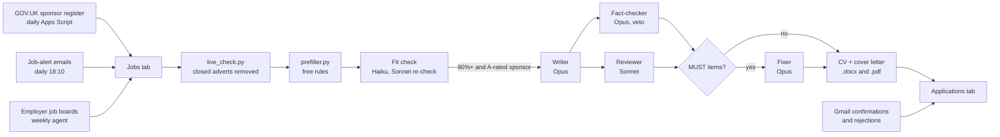

# AI Job Application Pipeline

An agentic pipeline that finds UK data jobs at employers licensed to sponsor Skilled Worker visas, screens
them against a verified record of my experience, and drafts a tailored CV and cover letter for each one
that passes. A separate agent fact-checks every claim before anything is saved.

I built it for my own search: I'm on a Graduate visa, so an employer that can't sponsor is a dead end no
matter how good the fit. The pipeline checks sponsorship first and writes nothing that isn't true.

**It never applies for a job, sends an email or contacts anyone.** It prepares; I review and apply.

## What it does

- Pulls job alerts from email (LinkedIn, Reed, NHS Jobs, Totaljobs, SimplyHired and others) and reads
  employer job boards directly (Greenhouse, Lever, Ashby).
- Matches every employer against the Home Office register of licensed sponsors, refreshed daily.
- Removes adverts that have closed, using plain HTTP checks rather than an LLM.
- Drops hopeless adverts with a free rules-based pre-filter (seniority, salary below the sponsorship floor,
  "no sponsorship" wording, duplicates) before any model is called.
- Scores the rest against a fact sheet with a cheap model, and writes packs only for 80%+ fits.
- Runs each pack past a small review panel: a writer, a fact-checker with a veto, and a combined
  hiring-manager / ATS / recruiter reviewer.
- Tracks everything in one Google Sheet, including applied dates and outcomes read back from Gmail.

## How it works



The order matters for cost. Each step is cheaper than the one after it, so the expensive model calls only
run on adverts that survived every free check. See [docs/architecture.md](docs/architecture.md).

| Stage | Runs | Tool | Cost per advert |
|---|---|---|---|
| Sponsor register refresh | daily 06:00 | Google Apps Script | free |
| Employer discovery | weekly | Python + Companies House bulk data | free |
| Job-alert parsing | daily 18:10 | Claude scheduled task | small |
| Live check | daily 17:45 | `live_check.py` | free |
| Pre-filter | every CV run | `prefilter.py` | free |
| Fit check | every CV run, 10 at a time | Haiku (Sonnet for 75-79%) | ~10-15k tokens |
| Pack (CV + letter + panel) | every CV run, max 5 | Opus + Sonnet | ~250k tokens |

## Repository layout

| Path | What it is |
|---|---|
| `pipeline/sponsors/` | `sponsor_check.py`: downloads, validates and diffs the sponsor register |
| `pipeline/discovery/` | Ranks sponsors by size and sector, finds their job boards, reads open roles |
| `pipeline/screening/` | `live_check.py`, `prefilter.py`, `fetch_jd.py` |
| `pipeline/tailoring/` | `build_cv.js` (CV .docx from JSON) and `check.py` (mechanical CV checks) |
| `apps-script/` | Google Apps Script that keeps the sponsor register tabs in the Sheet up to date |
| `prompts/scheduled/` | The four scheduled-task prompts, sanitised |
| `prompts/agents/` | Fit-check, writer, fact-checker, reviewer and fixer prompts |
| `examples/` | A fictional candidate: fact sheet, CV JSON, job description, rules |
| `docs/` | Architecture, Sheet schema, costs and lessons |
| `tests/` | Offline tests (no network, no keys) |

## Quick start

### 1. Clone and check

```bash
git clone https://github.com/SujanT21/ai-job-application-pipeline.git
cd ai-job-application-pipeline
python -m unittest discover -s tests -v
```

Python 3.10+ and the standard library only. The tests use the fictional candidate in `examples/`.

### 2. Try the free steps on the example data

```bash
python pipeline/screening/prefilter.py examples/jobs.example.csv examples/register_a_rated.example.csv out.csv
python pipeline/screening/live_check.py my_jobs.csv checked.csv      # needs a CSV with a "link" column
python pipeline/sponsors/sponsor_check.py                           # downloads today's register (~100k rows)
```

### 3. Build a CV from JSON

```bash
npm install
node pipeline/tailoring/build_cv.js examples/cv.example.json CV.docx
soffice --headless --convert-to pdf CV.docx
python pipeline/tailoring/check.py examples/cv.example.json examples/cover_letter.example.txt \
    examples/job_description.example.txt CV.pdf
```

### 4. Wire up the agents

The agent steps run as Claude scheduled tasks. Copy the prompts from `prompts/scheduled/`, replace
`<SPREADSHEET_ID>`, and give each task access to Gmail and Google Sheets. Put your own fact sheet next to
the prompts (see `examples/fact-sheet.example.md` for the format) and keep it out of git; `.gitignore`
already excludes it.

## Configuration

| Setting | Where | Default | Why |
|---|---|---|---|
| Sponsorship salary floor | `prefilter.py --floor` | 33,400 | Lowest salary a new entrant can be sponsored at for most data roles (2026 rules) |
| Fit threshold | `prompts/agents/fit_check.md` | 80% | Below this, panels kept rejecting the drafts anyway |
| Packs per run | CV-run prompt | 5 | Keeps one run inside the usage limit |
| Fit checks per batch | CV-run prompt | 10 | Never screen more than you can write packs for |
| `REED_API_KEY` | `.env` | none | Reed adverts only; everything else needs no key |

## Current limits

- **Some job boards block automated checks** (SimplyHired, Totaljobs). Their adverts are kept as "unknown",
  and the full job description often has to be pasted in by hand.
- **The fact sheet is manual.** It is the most important file and the slowest to build: every number has
  an approved wording and a list of forbidden variants.
- **Agents still need a person.** Application forms, supporting statements and the final "apply" are done by me.
- **Costs are real.** A pack is ~250k tokens. Running the CV job hourly once used up the usage limit and
  stopped the daily alert run; it now runs on demand. See [BUILD_JOURNAL.md](BUILD_JOURNAL.md).
- **UK-specific.** The sponsor register, salary floors and job sites are all UK.

## Further reading

- [docs/architecture.md](docs/architecture.md): every stage, input and output
- [docs/sheet-schema.md](docs/sheet-schema.md): the Google Sheet tabs and columns
- [docs/costs-and-lessons.md](docs/costs-and-lessons.md): where the tokens went and what changed
- [BUILD_JOURNAL.md](BUILD_JOURNAL.md): dated decisions
- [AGENTS.md](AGENTS.md): rules for AI coding agents working in this repo
